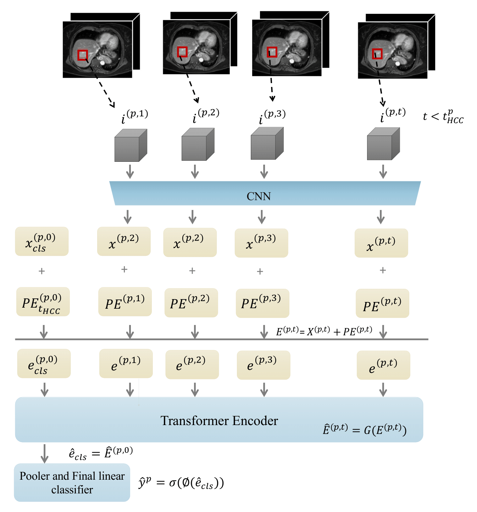

# HCCNet - code

PyTorch implementation of **HCCNet**: a 3D-ConvNeXt CNN backbone + Transformer encoder for disease prognosis from longitudinal 3D MRI, demonstrated on hepatocellular-carcinoma (HCC) surveillance in cirrhosis patients. The model reads a patient's whole *series* of 3D MRI scans: a 3D-ConvNeXt embeds each volume, and a Transformer processes the sequence (handling variable record lengths and irregular screening intervals). It is trained with two-stage self-supervised pre-training - DINO on the 3D-ConvNeXt backbone, then a sequence-order-prediction task on the Transformer - before fine-tuning on the binary HCC-onset target. Reference: arXiv:2501.10733 (Nolte et al. 2025).

This deposit is actively maintained (not frozen). It trains on a private, governed clinical cohort that is not redistributable: given that data the full pipeline reproduces every reported number from scratch (verified bit-exact), but the numbers cannot be reproduced without equivalent longitudinal-MRI surveillance data.



*HCCNet forward pass: each visit's 3D MRI volume is encoded by the 3D-ConvNeXt CNN into a per-visit embedding; time-based positional encodings (keyed to the years-before-diagnosis) are added, and the sequence - with a `[cls]` token - is processed by the Transformer encoder; a pooler and a final linear classifier output the HCC probability.*

## How to run (from this directory; package-style imports `from models.x` / `from utils.x`)

3D MRI is heavy, so training runs on an HPC (SLURM) cluster. Each stage takes two positional arguments, `[GROUP] [ARCH]`, and the four stages form ONE configuration chain: run them in order with the SAME pair, since each stage reads the previous one's hand-off weights. The `--paper` flag applies the published hyper-parameters (`utils/paper_config.py`); the drivers are `pretrain.py` / `train.py` / `test.py`.
```bash
sbatch hpc/stage1_dino_paper.slurm     dwi femto   # SSL DINO pre-training of the 3D-ConvNeXt backbone
sbatch hpc/stage2_decoder_paper.slurm  dwi femto   # Transformer pre-training (sequence-order-prediction)
sbatch hpc/stage3_finetune_paper.slurm dwi femto   # fine-tune the full model (internally: 5-fold CV x 10 seeds)
sbatch hpc/stage4_test_paper.slurm     dwi femto   # evaluate (AUROC / AUPRC / calibration)
```
The two arguments select the configuration:
- `GROUP` (the MRI modality set) in `{dwi, t1dce, t1iop}`: `dwi` = DW-MRI (4 b-values), `t1dce` = T1 dynamic contrast-enhanced (4 phases), `t1iop` = T1 in/out-of-phase + T2.
- `ARCH` (3D-ConvNeXt size) in `{femto, compact, pico, nano, tiny}`.

**To reproduce the paper, sweep all 5 groups x 5 architectures = 25 configuration chains** (the three main modalities plus the two constituent splits, `t1iop_only` and `t2_only`). The headline AUROC 0.901 / AUPRC 0.614 is the `dwi` group averaged across the five architectures; the other groups and the per-architecture spread populate the modality and ablation tables. A full cluster how-to (environment, smoke test, knobs, timings) is in `GETTING_STARTED.md`.

## Layout

- `models/` - `convnext3d.py` (3D ConvNeXt spatial backbone), `mednet.py` (the assembled CNN+Transformer model), `dinohead.py` (SSL projection head).
- `losses/` - `dinoloss.py` (SSL), `focalloss.py` / `binaryceloss.py` (the imbalanced HCC-onset target).
- `data/` - `datasets.py` (`CacheSeqDataset`), `splits.py` (`GroupStratifiedSplit`, no patient leakage), `transforms.py`, `utils.py`.
- `utils/` - `config.py`, `paper_config.py` (the paper's exact config + the hand-off naming helpers), `preprocessing.py`, `transforms.py`, `utils.py`.
- `pretrain.py` / `train.py` / `test.py` - the drivers; `hpc/stage{1..4}_*_paper.slurm` - the staged HPC pipeline.

## Pipeline (what each step does)

| Stage | Driver | Produces |
|---|---|---|
| 1 DINO | `pretrain.py --loss-fn dino` | self-supervised 3D-ConvNeXt backbone (single-channel, within-contrast-family augmentation), 32k steps |
| 2 decoder/SOP | `pretrain.py --loss-fn bce` | sequence-order-prediction pretraining of the Transformer encoder (CNN frozen), 8k steps |
| 3 fine-tune | `train.py --pretrained` | supervised full model, class-balanced BCE, 400 steps x 5-fold x 10-seed (= 50 runs) |
| 4 test | `test.py` | fold-ensemble metrics: Accuracy/Precision/Recall/F1, AUPRC/AUROC, ECE/MCE/Brier, cumulative-gain MAE, + reliability and cumulative-gain plots |

The strongest configuration reaches AUROC 0.901 / AUPRC 0.614 (DW-MRI, mean across architectures).

## Reproducing the paper (cluster)

Environment + data prep first: see `GETTING_STARTED.md`. Every reproduction job is a SLURM **array job** that takes **NO arguments** - the `(group, arch)` matrix is encoded by the array index, and the modality/arch tables live in `hpc/_repro_lib.sh`. Logs go to `logs/`; the 50 fold-seed checkpoints are written to the node's `/local` NVMe and discarded on exit, so only the ensemble metrics, one representative fold-0 checkpoint, the per-model predictions, and the plots persist to `results/model_diagnostics/`.

One command runs the whole thing (submits every stage with the right SLURM dependencies, then exits in seconds; SLURM runs the chain over the next few days, so you can log out):

```bash
bash hpc/run_all.sh        # no cap: uses up to your account's 8-job limit
bash hpc/run_all.sh 6      # cap every stage to 6 concurrent tasks (leaves 2 slots free)
```

Smoke test first (one tiny config, minutes): `sbatch hpc/repro_smoke.slurm`.

Or submit stages yourself, in this order (`sbatch hpc/<script>` runs uncapped = up to 8; later stages need `--dependency=afterok:<jobid>` of the earlier one):

| # | Script | Tasks | What | ~Per-config | After |
|---|---|---|---|---|---|
| 1 | `repro_dino.slurm` | 0-24 (5 groups x 5 archs) | DINO backbone pretraining (4 GPU); each group gets its OWN backbone (the 2 constituent splits are pre-trained only on their own 2 channels) | ~7 h (4 GPU; ~27 h on 1) | - |
| 2 | `repro_decoder.slurm` | 0-24 | SOP encoder pretraining | ~3 h | dino |
| 3 | `repro_finetune.slurm` | 0-24 (5 mods x 5 archs) | pretrained fine-tune + in-job ensemble test | ~4 h | decoder |
| 4 | `repro_ablation.slurm` | 0-5 (pico) | CNN-only + encoder-only pretraining ablation (+ in-job test) | ~4 h | finetune |
| 5 | `repro_baseline.slurm` | 0-24 | random-init fine-tune (baseline) + in-job test | ~4 h | ablation |
| 6 | `repro_fusion.slurm` | 0-2 (pico) | 3 fusion configs; each a self-contained DINO -> decoder -> finetune -> test chain | ~15 h | baseline |
| 7 | `repro_figures.slurm` | 1 | regenerate the 2 composite figures (`paper_figs.py`, offline from the predictions; no retrain) -> `results/figures/` | ~5 min | fusion |

There is no separate test stage: each of finetune / ablation / baseline / fusion ensemble-tests inside its own job, writing the metrics, per-model predictions, and plots to `results/model_diagnostics/`. The final `paper_figs.py` step rebuilds `calibration.png` + `cumulative_gain.png` from those predictions (matching the reliability and cumulative-gain tables); copy them into `manuscript/figures/` for the deposit. Ablation, baseline, and fusion are logically independent; `run_all.sh` serializes them only so the concurrency cap always holds.

Run a single config for a smoke test: `sbatch --array=0 hpc/repro_dino.slurm` (task 0 = `dwi` x `femto`).

**How long.** Per-config times are above. Total compute is on the order of a thousand-plus GPU-hours across the 25 chains. Wall-clock depends on cluster availability: the longest dependency chain (DINO -> decoder -> finetune) is ~14 h, so if the cluster runs all array tasks concurrently the full reproduction finishes in roughly **a day**; with limited GPUs the array tasks queue, so budget **2-4 days**.

The four older `stage{1..4}_*_paper.slurm` scripts remain for one-off single-config runs with explicit `GROUP ARCH` arguments (handy for debugging a single cell).

## Data

Institutional cirrhosis HCC-surveillance longitudinal 3D MRI: not public, under clinical governance, available from the collaborators on reasonable request. Large 3D volumes and the preprocessing cache stay on the cluster, never in this tree. `data/splits.py` enforces patient-grouped, label-stratified splits.

## License

See `license.txt` (Apache-2.0).


Phase pretraining restarts: `hpc/phase_impact.slurm` sets `HCCNET_PRETRAIN_RESTART` to the arm-specific persistent state file. The single-process trainer saves every 500 updates, resumes automatically if the file exists, and rejects mismatched training metadata. Worker/augmentation replay is not bitwise. Verify CPU interruption/restart behavior with `python tests/test_pretrain_restart.py`; `sbatch hpc/test_pretrain_restart.slurm` runs the same check in the configured cluster environment. New DINO/decoder allowances are 72h/16h.


## Updated-outcome radiologist review

`hpc/patient_review.slurm` runs inference only for PT_042, PT_200 and PT_214 across the five saved Pico fold-0 model groups. Submit from the cluster project directory with `sbatch radiologist_code/hpc/patient_review.slurm` after syncing the source snapshot. Required external inputs are the existing `results/model_weights/weights_fold0_*_pico_paper_ft.pth`, `radiologist_predictions/*_pico_paper_ft.npz`, original NIfTI data and labels, and the packed radiologist environment documented above. Output is `results/patient_figures/new_outcomes/saliency`, separate from the original eight cases. `HCCNET_REVIEW_PATIENTS` selects saved held-out IDs; `HCCNET_DIAGNOSIS_DATES` points to `review_diagnosis_dates.json`. Updated dates affect display labels only. Model timing inputs retain original label deltas. No slice browser or sprite export remains.

`audit_review_headers.py` reads only acquisition header metadata for these cases. Run it on a compute node through `hpc/review_headers.slurm`, not on a login node. The header output cannot confirm phase identity when sequence descriptions are empty.
